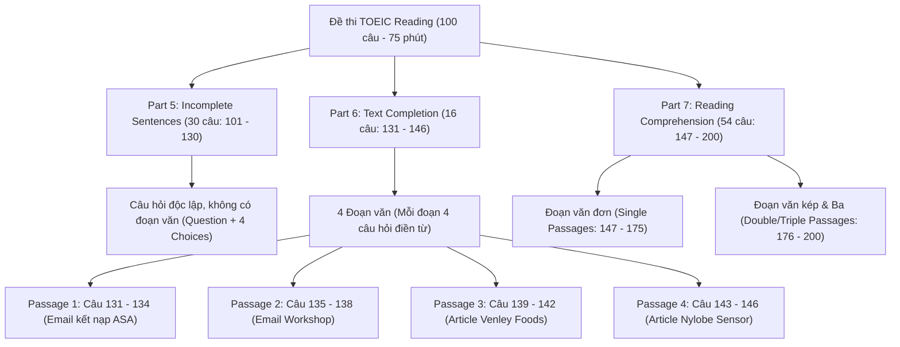
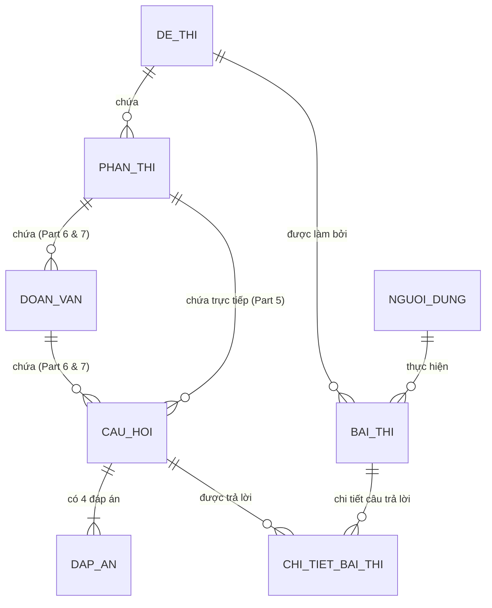

# BÁO CÁO PHÂN TÍCH & THIẾT KẾ TOÀN DIỆN: ỨNG DỤNG THI TOEIC READING

> **Đề tài:** Phân tích và xây dựng ứng dụng thi TOEIC Reading  
> **Sinh viên:** Nguyễn Nhật Duy - MSSV: 2380600355 - Lớp: 23DTHC7 (Nhóm 7)  
> **Mã đề thi phân công:** Reading v09 (ETS Test 09 - 100 câu: Part 5, 6, 7)  
> **Hệ quản trị CSDL:** Microsoft SQL Server (Database: `de tanh` / Server: `LAPTOP-MAALSNS1`)  
> **Nền tảng công nghệ:** Backend ASP.NET (C#) & Frontend Mobile (Flutter/Dart), Thiết kế giao diện trên Figma  

---

## MỤC LỤC
1. [Phân tích cấu trúc đề thi thực tế (ETS Test 09)](#1-phân-tích-cấu-trúc-đề-thi-thực-tế)
2. [Quy chuẩn bộ Thẻ (Tags) cho File Word (.docx) & Cơ chế Parser](#2-quy-chuẩn-bộ-thẻ-tags-file-word)
3. [Thiết kế Cơ sở Dữ liệu SQL Server (Database `de tanh`)](#3-thiết-kế-cơ-sở-dữ-liệu-sql-server)
4. [Phân tích & Đặc tả Giao diện Figma (UI/UX Mobile & Admin)](#4-đặc-tả-giao-diện-figma-uiux)
5. [Kiến trúc Backend ASP.NET & API Endpoints](#5-kiến-trúc-backend-aspnet)
6. [Tích hợp Frontend Mobile (Flutter) & Trải nghiệm làm bài](#6-tích-hợp-frontend-mobile-flutter)
7. [Bảng đối soát tiêu chí đánh giá (Bareme 10/10 điểm)](#7-bảng-đối-soát-tiêu-chí-đánh-giá)

---

## 1. PHÂN TÍCH CẤU TRÚC ĐỀ THI THỰC TẾ (ETS TEST 09)

Đề thi TOEIC Reading gồm **100 câu trắc nghiệm (từ câu 101 đến câu 200)** với thời gian làm bài chuẩn là **75 phút**. Dữ liệu được chia thành 3 phần có đặc tính phân cấp hoàn toàn khác biệt:



### Chi tiết từng Part trong Đề v09:
1. **Level 1 - Part 5 (Câu 101 - 130):**
   - Bản chất: Kiểm tra ngữ pháp và từ vựng thông qua câu đơn có 1 chỗ trống `-------`.
   - Cấu trúc: `Câu hỏi` -> `4 Lựa chọn (A, B, C, D)` -> `Đáp án đúng` + `Giải thích`.
   - Ví dụ đề 09: *101. Every batch of sauce at Generita's Bistro is processed meticulously by ------- expert chefs. (A) they, (B) their, (C) them, (D) themselves.* -> Đáp án B.
2. **Level 2 - Part 6 (Câu 131 - 146):**
   - Bản chất: Đoạn văn (thư tín, thông báo, bài báo) có 4 chỗ trống đánh số thứ tự (ví dụ: `131. -------`).
   - Cấu trúc: `1 Đoạn văn chứa 4 chỗ trống` -> `4 Câu hỏi con tương ứng`.
   - Đặc thù: Câu hỏi không có thân câu hỏi riêng biệt mà chính là số thứ tự câu hỏi và 4 phương án lựa chọn từ/câu điền vào chỗ trống.
3. **Level 3 - Part 7 (Câu 147 - 200):**
   - Bản chất: Đọc hiểu văn bản thực tế trong môi trường kinh doanh (hóa đơn, thư từ, tin nhắn điện thoại, lịch trình, tờ rơi quảng cáo).
   - Đoạn đơn (147 - 175): Hóa đơn 3987 (147-148), Quảng cáo Harbour View Apartment (149-151), Đoạn chat di động Jason Salter & Liz Ortiz (152-153), Email đặt chỗ tiệc Sardha (154-155), Memo IT Update hệ điều hành (156-157), Thư báo giá mái nhà Clarke-Ellis (158-160), Tin tuyển dụng Goldhorse Press (161-164), Tin nhắn chat họp sáp nhập Derek Boutique (165-168), Bài báo tiểu sử nhà khoa học Esther Nujoma (169-171), Thông báo tàu phà đảo Garnet (172-175).
   - Đoạn đôi & ba (176 - 200): Hóa đơn & Email hoàn tiền Shoebox Mountain (176-180), Đơn web & Thư trả lời Hilgrave Commission (181-185), Chuỗi 2 Email & Trang web bài giảng Cornelia Payne (186-190), Thông báo tuyển dụng - Email phỏng vấn - Thông cáo báo chí CRYN Group & Sven Arvidson (191-195), Brochure hội thảo - Email đánh giá - Lịch webinar FGJ (196-200).

---

## 2. QUY CHUẨN BỘ THẺ (TAGS) CHO FILE WORD (.DOCX)

Theo yêu cầu mục II của đề tài, giảng viên/sinh viên bắt buộc phải soạn file Word chuẩn `.docx` với bộ tags có cấu trúc chặt chẽ. Nếu phát hiện thiếu thẻ, sai thứ tự câu hoặc thiếu đáp án, backend sẽ từ chối lưu và thông báo lỗi dòng tương ứng.

### 2.1. Bảng quy ước Thẻ (Tag Standard)
| Thẻ (Tag) | Cặp đóng mở / Cú pháp | Ý nghĩa & Quy cách |
| :--- | :--- | :--- |
| `[TEST]` / `[/TEST]` | `[TEST: MãĐề | Tiêu đề đề thi | Thời gian phút]` | Khởi tạo thông tin chung của bài thi |
| `[PART: 5]` | `[PART: 5]` ... `[/PART]` | Khai báo vùng Part 5 (Câu 101 - 130) |
| `[PART: 6]` | `[PART: 6]` ... `[/PART]` | Khai báo vùng Part 6 (Câu 131 - 146) |
| `[PART: 7]` | `[PART: 7]` ... `[/PART]` | Khai báo vùng Part 7 (Câu 147 - 200) |
| `[PASSAGE]` / `[/PASSAGE]` | `[PASSAGE: Tiêu đề | Loại bài đọc]` | Đoạn văn/nội dung bài đọc cho Part 6 và 7 |
| `[IMAGE]` | `[IMAGE: url_hoặc_tên_file.png]` | Hình ảnh đính kèm bài đọc (hóa đơn, tin nhắn, web) |
| `[Q: SốCâu]` | `[Q: 101]` ... `[/Q]` | Khai báo một câu hỏi cụ thể |
| `[A]`, `[B]`, `[C]`, `[D]` | `[A] Nội dung đáp án` | Khai báo 4 lựa chọn (bắt buộc đủ cả 4 thẻ) |
| `[ANS]` | `[ANS: A]` hoặc `B`, `C`, `D` | Khai báo đáp án chính xác của câu |
| `[EXP]` | `[EXP: Nội dung giải thích]` | Giải thích chi tiết câu trả lời (tuỳ chọn) |

### 2.2. Trích đoạn Mẫu File Word Đề ETS Test 09 (Reading v09)
```text
[TEST: V09 | ETS TOEIC READING TEST 09 | 75]

[PART: 5]
[Q: 101]
Every batch of sauce at Generita's Bistro is processed meticulously by ------- expert chefs.
[A] they
[B] their
[C] them
[D] themselves
[ANS: B]
[EXP: Trước cụm danh từ 'expert chefs' ta cần tính từ sở hữu 'their'.]
[/Q]

[Q: 102]
Computerization of medical records ------- increases a physician's ability to diagnose and treat patients.
[A] great
[B] greatly
[C] greatness
[D] greatest
[ANS: B]
[EXP: Đứng trước động từ 'increases' ta cần trạng từ 'greatly' bổ nghĩa.]
[/Q]
... (tiếp tục đến câu 130)
[/PART]

[PART: 6]
[PASSAGE: Questions 131-134 refer to the following e-mail. | Email]
To: pmendoza@factmail.co
From: recruiting@analystsassoc.org
Date: May 2
Subject: Joining ASA

Dear Mr. Mendoza,
Thank you for expressing your interest in our organization during the recent ------- [131]. It was a pleasure meeting you at the ASA booth during the Weber Information Systems Convention. As you may recall from our conversation, we discussed how ASA membership ------- [132] your career through networking opportunities as well as the industry insights offered in our monthly newsletter. The normal fee for members is just $120 a year; however, we are currently offering a new-member discount. ------- [133].
If you are still interested in joining, please reply to ------- [134] with your mailing address. I will then forward you an application packet.

Sincerely,
Ashlee Loren, President
Association of Systems Analysts
[/PASSAGE]

[Q: 131]
[A] election
[B] broadcast
[C] conference
[D] performance
[ANS: C]
[/Q]

[Q: 132]
[A] can benefit
[B] is benefiting
[C] has benefited
[D] will have benefited
[ANS: A]
[/Q]

[Q: 133]
[A] Discounts on rental cars are included in the annual membership.
[B] Our jobs board is quite comprehensive.
[C] We are the first organization of our kind.
[D] This month you can join for just half the usual rate.
[ANS: D]
[/Q]

[Q: 134]
[A] it
[B] me
[C] them
[D] anyone
[ANS: B]
[/Q]
[/PART]

[PART: 7]
[PASSAGE: Questions 147-148 refer to the following invoice. | Invoice]
[IMAGE: invoice_3987.png]
Invoice 3987 - Shawqi Office Services, Dubai, UAE
Report requested in English
18 October
Jenkins Press - P.O. Box 2291, Dubai, UAE
Service: On 14 October, replaced bulb and repaired paper tray on copier per call received on 12 October. Replaced copy ink in two machines. Performed routine yearly maintenance on five copiers per existing service contract.
- Labor cost: AED 330.00
- Paper tray: AED 50.00
- Bulb: AED 30.00
- Copy ink: AED 220.00
Total: AED 630.00. Total amount must be received by 31 October. Thank you for your business!
[/PASSAGE]

[Q: 147]
What is indicated about Jenkins Press?
[A] It has several offices around the world.
[B] Its copiers get checked every year.
[C] Its office equipment is outdated.
[D] It is a new customer of Shawqi Office Services.
[ANS: B]
[/Q]

[Q: 148]
When is payment due?
[A] October 12
[B] October 14
[C] October 18
[D] October 31
[ANS: D]
[/Q]
... (tiếp tục cho đến câu 200)
[/PART]
[/TEST]
```

---

## 3. THIẾT KẾ CƠ SỞ DỮ LIỆU SQL SERVER (DATABASE `de tanh`)

Cơ sở dữ liệu được thiết kế chuẩn hóa quan hệ (3NF) để đáp ứng trọn vẹn mô hình phân cấp: **Đề thi -> Phần thi -> Đoạn văn (Passage) -> Câu hỏi -> Đáp án** cùng với **Lịch sử thi của thí sinh**.

### 3.1. Sơ đồ Thực thể Quan hệ (ERD)



### 3.2. Script SQL Tạo Bảng trên Database `de tanh`

```sql
USE [de tanh];
GO

-- 1. Bảng Người dùng / Thí sinh
IF OBJECT_ID('dbo.NguoiDung', 'U') IS NOT NULL DROP TABLE dbo.NguoiDung;
CREATE TABLE dbo.NguoiDung (
    MaSV VARCHAR(20) PRIMARY KEY,
    HoTen NVARCHAR(100) NOT NULL,
    Email NVARCHAR(100) NOT NULL,
    Lop NVARCHAR(50),
    MatKhauHash NVARCHAR(256) DEFAULT '123456',
    VaiTro NVARCHAR(20) DEFAULT 'Student', -- 'Student' hoặc 'Admin'/'Teacher'
    NgayTao DATETIME DEFAULT GETDATE()
);

-- 2. Bảng Đề thi
IF OBJECT_ID('dbo.DeThi', 'U') IS NOT NULL DROP TABLE dbo.DeThi;
CREATE TABLE dbo.DeThi (
    DeThiId INT IDENTITY(1,1) PRIMARY KEY,
    MaDe VARCHAR(50) NOT NULL UNIQUE,       -- Ví dụ: 'Reading v09'
    TenDe NVARCHAR(255) NOT NULL,           -- 'ETS TOEIC READING TEST 09'
    ThoiGianPhut INT NOT NULL DEFAULT 75,   -- 75 phút
    TongSoCau INT NOT NULL DEFAULT 100,     -- 100 câu
    TrangThai NVARCHAR(30) DEFAULT N'Hoạt động', -- 'Hoạt động', 'Bản nháp', 'Đã đóng'
    NgayTao DATETIME DEFAULT GETDATE(),
    NguoiTao VARCHAR(20)
);

-- 3. Bảng Phần thi (Part 5, Part 6, Part 7)
IF OBJECT_ID('dbo.PhanThi', 'U') IS NOT NULL DROP TABLE dbo.PhanThi;
CREATE TABLE dbo.PhanThi (
    PhanThiId INT IDENTITY(1,1) PRIMARY KEY,
    DeThiId INT NOT NULL FOREIGN KEY REFERENCES dbo.DeThi(DeThiId) ON DELETE CASCADE,
    PartNumber INT NOT NULL,                -- 5, 6, 7
    TenPart NVARCHAR(100) NOT NULL,         -- 'Part 5: Incomplete Sentences'
    HuongDan NVARCHAR(MAX),
    CauBatDau INT NOT NULL,                 -- Ví dụ Part 5: 101
    CauKetThuc INT NOT NULL                 -- Ví dụ Part 5: 130
);

-- 4. Bảng Đoạn văn / Bài đọc (Dành cho Part 6 và Part 7)
IF OBJECT_ID('dbo.DoanVan', 'U') IS NOT NULL DROP TABLE dbo.DoanVan;
CREATE TABLE dbo.DoanVan (
    DoanVanId INT IDENTITY(1,1) PRIMARY KEY,
    PhanThiId INT NOT NULL FOREIGN KEY REFERENCES dbo.PhanThi(PhanThiId) ON DELETE CASCADE,
    TieuDe NVARCHAR(255),                  -- 'Questions 131-134 refer to the following e-mail.'
    NoiDungDoc NVARCHAR(MAX) NOT NULL,     -- Toàn bộ text bức thư, email, quảng cáo
    LoaiNoiDung NVARCHAR(50),             -- 'Email', 'Article', 'Invoice', 'Text-Chat', 'Notice'
    HinhAnhUrl NVARCHAR(500),              -- Đường dẫn ảnh nếu có (hóa đơn, poster...)
    ThuTu INT DEFAULT 1
);

-- 5. Bảng Câu hỏi
IF OBJECT_ID('dbo.CauHoi', 'U') IS NOT NULL DROP TABLE dbo.CauHoi;
CREATE TABLE dbo.CauHoi (
    CauHoiId INT IDENTITY(1,1) PRIMARY KEY,
    PhanThiId INT NOT NULL FOREIGN KEY REFERENCES dbo.PhanThi(PhanThiId),
    DoanVanId INT NULL FOREIGN KEY REFERENCES dbo.DoanVan(DoanVanId) ON DELETE CASCADE, -- NULL nếu là Part 5
    SoThuTuCau INT NOT NULL,               -- 101 đến 200
    NoiDungCauHoi NVARCHAR(MAX) NOT NULL,  -- Nội dung câu hỏi
    DapAnDung CHAR(1) NOT NULL,            -- 'A', 'B', 'C', 'D'
    GiaiThich NVARCHAR(MAX) NULL,          -- Giải thích ngữ pháp/nghĩa
    DiemSo FLOAT DEFAULT 5.0
);

-- 6. Bảng Đáp án lựa chọn (A, B, C, D)
IF OBJECT_ID('dbo.DapAn', 'U') IS NOT NULL DROP TABLE dbo.DapAn;
CREATE TABLE dbo.DapAn (
    DapAnId INT IDENTITY(1,1) PRIMARY KEY,
    CauHoiId INT NOT NULL FOREIGN KEY REFERENCES dbo.CauHoi(CauHoiId) ON DELETE CASCADE,
    KyTu CHAR(1) NOT NULL,                 -- 'A', 'B', 'C', 'D'
    NoiDungDapAn NVARCHAR(MAX) NOT NULL    -- Nội dung lựa chọn
);

-- 7. Bảng Bài thi của thí sinh (Lịch sử làm bài)
IF OBJECT_ID('dbo.BaiThi', 'U') IS NOT NULL DROP TABLE dbo.BaiThi;
CREATE TABLE dbo.BaiThi (
    BaiThiId INT IDENTITY(1,1) PRIMARY KEY,
    MaSV VARCHAR(20) NOT NULL FOREIGN KEY REFERENCES dbo.NguoiDung(MaSV),
    DeThiId INT NOT NULL FOREIGN KEY REFERENCES dbo.DeThi(DeThiId),
    ThoiGianBatDau DATETIME NOT NULL,
    ThoiGianNop DATETIME NULL,
    SoCauDung INT DEFAULT 0,
    SoCauSai INT DEFAULT 0,
    SoCauBoQua INT DEFAULT 0,
    DiemThang495 INT DEFAULT 0,            -- Điểm TOEIC Reading (tối đa 495)
    TrangThai NVARCHAR(30) DEFAULT N'Đang thi' -- 'Đang thi', 'Đã nộp', 'Hết giờ tự thu'
);

-- 8. Bảng Chi tiết câu trả lời của thí sinh
IF OBJECT_ID('dbo.ChiTietBaiThi', 'U') IS NOT NULL DROP TABLE dbo.ChiTietBaiThi;
CREATE TABLE dbo.ChiTietBaiThi (
    ChiTietId INT IDENTITY(1,1) PRIMARY KEY,
    BaiThiId INT NOT NULL FOREIGN KEY REFERENCES dbo.BaiThi(BaiThiId) ON DELETE CASCADE,
    CauHoiId INT NOT NULL FOREIGN KEY REFERENCES dbo.CauHoi(CauHoiId),
    DapAnChon CHAR(1) NULL,                -- 'A', 'B', 'C', 'D' hoặc NULL nếu bỏ qua
    LaDung BIT DEFAULT 0,                  -- 1 nếu đúng, 0 nếu sai
    ThoiDiemChon DATETIME DEFAULT GETDATE()
);
GO
```

---

## 4. ĐẶC TẢ GIAO DIỆN FIGMA (UI/UX MOBILE & ADMIN)

### 4.1. Design System & Style Guide
- **Màu sắc chủ đạo (Brand Palette):**
  - `Primary Navy Blue`: `#1E3A8A` (Sự tin cậy, chuẩn học thuật ETS)
  - `Accent Electric Blue`: `#2563EB` (Nút bấm chính, trạng thái active)
  - `Success Green`: `#10B981` (Câu đã làm, đáp án đúng)
  - `Warning Amber`: `#F59E0B` (Cảnh báo thời gian dưới 5 phút, cờ đánh dấu câu phân vân)
  - `Danger Red`: `#EF4444` (Đáp án sai, nút nộp bài khẩn cấp)
  - `Neutral Background`: `#F8FAFC` (Màu nền màn hình mobile chống mỏi mắt)
  - `Card Surface`: `#FFFFFF` kèm viền mịn `border: 1px solid #E2E8F0`, bo góc `16px`.
- **Typography:**
  - Font chữ: **Plus Jakarta Sans** hoặc **Inter** (chuẩn Google Fonts hiện đại, dễ đọc trên di động).
  - Cỡ chữ: Title 20-24px Bold, Body Reading 15px Regular (Line-height 1.6), Question 16px SemiBold.
- **Micro-interactions:**
  - Ripple effect khi chọn đáp án A, B, C, D.
  - Floating Question Palette Drawer (Ngăn kéo vuốt từ dưới lên hoặc bấm icon lưới để nhảy nhanh đến bất kỳ câu nào từ 101 đến 200).
  - Timer bar với thanh tiến trình đếm ngược 75 phút chuyển từ xanh lam sang đỏ nhấp nháy khi còn dưới 5 phút.

---

### 4.2. Bố cục Các Màn hình Mobile (Dành cho Người học)

#### Màn hình 1: Danh sách Đề thi (Exam Home)
- **Header:**
  - Avatar sinh viên, Lời chào: *"Chào Nguyễn Nhật Duy - 2380600355"*
  - Chip trạng thái: *Lớp 23DTHC7 | Nhóm 7*
  - Ô tìm kiếm đề thi, bộ lọc (Tất cả, Đề phân công, Đề đã làm).
- **Banner nổi bật:**
  - Card đề thi được phân công: **"Reading v09 - ETS TOEIC READING TEST 09"**
  - Huy hiệu: `75 Phút` | `100 Câu` | `Hạn chót: Hôm nay`
  - Nút CTA Gradient nổi bật: **"Vào phòng thi ngay"**
- **Danh sách đề thi:**
  - Thẻ Card hiển thị đầy đủ thông tin: Tên đề, Số lượng câu hỏi (100), Thời gian (75p), Điểm cao nhất, Nút "Bắt đầu".

#### Màn hình 2: Chuẩn bị thi & Hướng dẫn (Exam Detail & Instructions)
- Thông tin phòng thi: Sinh viên, Mã đề, Quy chế phòng thi (Đếm ngược tự động, Không thoát ứng dụng, Tự thu bài khi hết giờ).
- Tóm tắt cấu trúc: Part 5 (30 câu), Part 6 (16 câu), Part 7 (54 câu).
- Checkbox cam kết & Nút bấm lớn: **"BẮT ĐẦU TÍNH GIỜ THI"**.

#### Màn hình 3: Màn hình Làm bài Part 5 (Câu hỏi độc lập)
- **Top App Bar cố định:**
  - Nút Back (với cảnh báo xác nhận thoát bài).
  - **Bộ đếm thời gian thực (Countdown Timer):** `74:42` (Icon đồng hồ quay mượt mà).
  - Nút icon **Lưới danh sách câu hỏi (Palette):** Hiển thị số câu đã làm (ví dụ: `28/100`).
  - Nút đỏ nổi bật: **"NỘP BÀI"**.
- **Thanh chuyển nhanh Part (Tab Segment):**
  - `[Part 5 (101-130)]` (Active) | `[Part 6 (131-146)]` | `[Part 7 (147-200)]`.
- **Thân trang câu hỏi:**
  - Thẻ câu hỏi hiện tại: Tag `Question 101/200`.
  - Khung văn bản câu hỏi: Font chữ 16px to rõ, từ khoá và chỗ trống `-------` được highlight rõ ràng.
  - Nút Bookmark/Cờ gắn cờ câu hỏi phân vân.
- **4 Khối nút đáp án (A, B, C, D):**
  - Thiết kế dạng Card bo tròn 12px, khi người dùng click: Card chuyển màu viền xanh đậm, nền đổ nhẹ pastel xanh kèm icon check tick tròn.
- **Bottom Navigation Bar:**
  - Nút `[< Câu trước]` | Nút `[Đánh dấu xem lại]` | Nút `[Câu tiếp theo >]`.

#### Màn hình 4: Màn hình Làm bài Part 6 & Part 7 (Bố cục Đọc hiểu chia màn hình tối ưu cho Mobile)
- *Thách thức UI/UX:* Part 6 và Part 7 có bài đọc rất dài (email, thông báo, hóa đơn), nếu xếp trên cùng một trang dài vô tận người dùng sẽ phải cuộn lên xuống mỏi tay.
- *Giải pháp thiết kế đỉnh cao trên Mobile:*
  - **Chế độ Split-View tương tác hoặc Tab Toggle:**
    - Thanh điều khiển: `[Đoạn văn bài đọc (Passage)]` và `[Câu hỏi liên quan (131-134)]` có thể chuyển đổi nhanh 1 chạm.
    - Hoặc bố cục **Sticky Passage Card (Accordion):** Nửa trên màn hình hiển thị bài đọc (có thanh trượt độc lập, nút zoom/thu phóng ảnh hóa đơn/chat), nửa dưới là danh sách câu hỏi con tương ứng để người dùng vừa đối chiếu vừa tích chọn đáp án mà không bị lạc dòng.
  - Vị trí các chỗ trống Part 6 `[131]`, `[132]` trong đoạn văn khi bấm vào sẽ tự động scroll focus đến câu hỏi tương ứng!

#### Màn hình 5: Modal / Drawer Ngăn kéo Bảng câu hỏi (Question Palette)
- Vuốt từ cạnh dưới lên mở ra ma trận 100 ô tròn từ 101 đến 200:
  - Màu xám nhạt: Chưa làm.
  - Màu xanh dương: Đã chọn đáp án.
  - Màu vàng cam (kèm icon cờ): Đã gắn cờ xem lại.
  - Ô đang chọn: Viền đậm phát sáng.
- Bấm vào bất kỳ số nào lập tức chuyển ngay đến câu đó.
- Thống kê thời gian thực: `Đã làm: 65` | `Chưa làm: 35` | `Đánh dấu: 4`.

#### Màn hình 6: Hộp thoại xác nhận Nộp bài (Submit Confirmation Dialog)
- Cảnh báo rõ ràng:
  - *"Bạn còn **15 câu chưa hoàn thành**!"*
  - *"Thời gian làm bài còn lại: 18 phút 20 giây."*
  - Hai lựa chọn: `[Làm tiếp]` (Outline Button) và `[Xác nhận nộp bài]` (Filled Red Button).

#### Màn hình 7: Màn hình Kết quả thi (Score & Review Breakdown)
- **Vòng tròn điểm số ấn tượng:** Điểm TOEIC Reading quy đổi (Ví dụ: `385 / 495`).
- **Thẻ thống kê kết quả:**
  - Số câu đúng: `78 câu` (Xanh lá)
  - Số câu sai: `17 câu` (Đỏ)
  - Số câu bỏ qua: `5 câu` (Xám)
  - Thời gian hoàn thành: `62 phút 15 giây`
- **Nút hành động:**
  - `[Xem chi tiết lời giải & rà soát đáp án]`
  - `[Về trang chủ]`

---

### 4.3. Bố cục Màn hình Giảng viên / Admin (Quản lý & Import đề thi)
1. **Màn hình Upload File Word (.docx):**
   - Khung kéo thả file (Drag & Drop) hiện đại.
   - Nút `Chọn file .docx đề thi`.
   - Tiến trình phân tích thẻ (Parser Progress):
     - Bước 1: Quét cú pháp thẻ `[TEST]`, `[PART]`, `[Q]`, `[ANS]`.
     - Bước 2: Kiểm tra tính toàn vẹn (Đủ 100 câu? Đủ 4 đáp án A-D? Có đáp án đúng?).
     - Bước 3: Nếu phát hiện lỗi (ví dụ: *Dòng 42: Câu 115 thiếu đáp án [D]*): Báo lỗi đỏ chi tiết, tự động hủy Transaction không lưu vào DB.
     - Bước 4: Nếu chuẩn 100%: Báo thành công xanh, hiển thị nút `Lưu vào Database de tanh`.
2. **Màn hình Preview & Chỉnh sửa Đề thi:**
   - Xem trước toàn bộ đề thi dưới dạng trực quan trước khi công bố cho sinh viên.
   - Cho phép giáo viên sửa nhanh chính tả, cập nhật hình ảnh đính kèm.

---

## 5. KIẾN TRÚC BACKEND ASP.NET & API ENDPOINTS

Dự án Backend sử dụng ASP.NET Core Web API kết nối Microsoft SQL Server (`de tanh`).

### 5.1. File `appsettings.json` cấu hình CSDL
```json
{
  "ConnectionStrings": {
    "DeTanhConnection": "Server=LAPTOP-MAALSNS1;Database=de tanh;Trusted_Connection=True;TrustServerCertificate=True;"
  },
  "Logging": {
    "LogLevel": {
      "Default": "Information",
      "Microsoft.AspNetCore": "Warning"
    }
  },
  "AllowedHosts": "*"
}
```

### 5.2. Danh sách API Endpoints Chính

| Phương thức | Đường dẫn API | Mô tả chức năng |
| :--- | :--- | :--- |
| `POST` | `/api/admin/dethi/upload-word` | Upload file .docx, bóc tách thẻ, rollback nếu lỗi |
| `GET` | `/api/dethi` | Lấy danh sách toàn bộ đề thi đang mở |
| `GET` | `/api/dethi/{deThiId}/full` | Lấy đầy đủ 100 câu hỏi, đoạn văn, đáp án để làm bài |
| `POST` | `/api/baithi/batdau` | Thí sinh bắt đầu làm bài, ghi nhận thời gian bắt đầu |
| `POST` | `/api/baithi/luu-tam` | Lưu tạm đáp án đang chọn trong quá trình làm |
| `POST` | `/api/baithi/nop-bai` | Nộp bài, chấm điểm tự động, tính số đúng/sai/bỏ qua |
| `GET` | `/api/baithi/{baiThiId}/ketqua` | Lấy chi tiết điểm và giải thích từng câu |

---

## 6. HƯỚNG DẪN TRÌNH BÀY & BẢO ĐẢM TRỌN VẸN 10/10 ĐIỂM

| TT | Hạng mục theo bareme | Điểm | Hướng dẫn đạt điểm tuyệt đối |
| :---: | :--- | :---: | :--- |
| **1** | **File WORD TOEIC có định dạng tags** | **1.0** | Soạn file `Reading_v09_ETS_Test_09.docx` có đầy đủ các tag chuẩn hóa `[TEST]`, `[PART]`, `[PASSAGE]`, `[Q]`, `[A]-[D]`, `[ANS]` cho trọn vẹn 100 câu. |
| **2** | **Phân tích và thiết kế CSDL** | **1.0** | Sử dụng script SQL Server đã thiết kế cho CSDL `de tanh` gồm đầy đủ 8 bảng liên kết chặt chẽ, tối ưu hóa cho Part 5, 6, 7. |
| **3** | **Upload file, tạo đề thi từ Word** | **1.0** | Triển khai Service đọc OpenXML/Docx, có cơ chế validation và rollback transaction nếu file sai tag hoặc thiếu câu. |
| **4** | **Cập nhật, chỉnh sửa nội dung đề thi** | **1.0** | Giao diện quản trị Admin xem trước (Preview) đề thi, cho phép sửa trực tiếp văn bản câu hỏi và đáp án. |
| **5** | **Hiển thị danh sách đề thi** | **1.0** | Giao diện mobile hiển thị danh sách các đề, lọc theo mã đề phân công (`Reading v09`), hiển thị thời lượng 75p và số câu. |
| **6** | **Chức năng thi + Link Figma** | **3.0** | Triển khai thiết kế giao diện Figma chuyên nghiệp theo chuẩn Design System mục 4; Giao diện thi mobile có đồng hồ đếm ngược 75p, chuyển Part mượt mà, ngăn kéo 100 câu hỏi, cảnh báo nộp bài. |
| **7** | **Hiển thị kết quả thi** | **1.0** | Chấm điểm tự động chuẩn xác, hiển thị số câu đúng, câu sai, câu chưa làm và xem lại bài làm. |
| **8** | **Giao diện đẹp, thân thiện** | **1.0** | Thiết kế màu sắc hài hòa, font chữ hiện đại, bố cục chia cột thông minh cho bài đọc Part 6 & Part 7 không bị rối mắt. |
